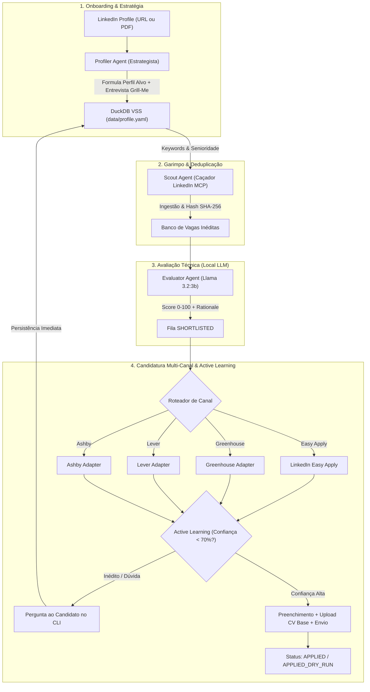

# OPEN-JOB-LOOP

```text
   ____  ____  _____ _   __       __________  ____       __    ____  ____  ____ 
  / __ \/ __ \/ ___// | / /      / / / / __ \/ __ )     / /   / __ \/ __ \/ __ \
 / / / / /_/ / __/ /  |/ /  __  / / / / / / / __  |    / /   / / / / / / / /_/ /
/ /_/ / ____/ /___/ /|  /  / /_/ / /_/ / /_/ / /_/ /   / /___/ /_/ / /_/ / ____/ 
\____/_/   /_____/_/ |_/   \____/\____/\____/_____/   /_____/\____/\____/_/
```

> **Agente Autônomo e Colaborativo de Busca & Candidatura de Vagas com Modelos Locais, Arquitetura Hexagonal, DuckDB VSS e Multi-Agentes.**

O **OPEN-JOB-LOOP** é uma ferramenta de automação de carreira ("unfair advantage") 100% orientada a CLI, sem dependência de interfaces web pesadas. Ele executa em loops fechados para descobrir vagas reais no LinkedIn, deduplicar registros, avaliar compatibilidade técnica com LLMs locais e preencher formulários do LinkedIn Easy Apply de forma personalizada utilizando contexto multi-agente e RAG vetorial.

---

## 🤖 Arquitetura Multi-Agente & Multi-Canal

O sistema opera através de agentes especializados colaborando com memória compartilhada no **DuckDB VSS** e suporte nativo a múltiplos canais de candidatura:



1. **Profiler Agent**: Ingesta o perfil do LinkedIn (URL via Playwright ou PDF exportado), formula a especificação da vaga-alvo ideal, conduz a entrevista interativa adaptativa (*grill-me*) e vetoriza o perfil no DuckDB VSS.
2. **Scout Agent**: Conecta-se ao Model Context Protocol (MCP) do LinkedIn para garimpar vagas reais no mercado.
3. **Evaluator Agent**: Avalia cada vaga contra o background do candidato usando Llama 3.2 local via Instructor, gerando *fit score* (0-100), justificativa técnica e skills compatíveis.
4. **FormFiller & ATS Adapters**: Módulos Playwright especializados para **LinkedIn Easy Apply**, **Greenhouse**, **Lever** e **Ashby**, preenchendo formulários, anexando o currículo base em PDF e respondendo a perguntas discursivas.
5. **Active Learning Service**: Detecta perguntas inéditas ou com confiança < 70% durante o preenchimento, consulta o usuário pontualmente no terminal e salva a resposta no DuckDB VSS para aprendizado contínuo.

---

## ⚙️ Pré-Requisitos

1. **Python 3.10+** (recomendado Python 3.12).
2. **Ollama** rodando localmente (`http://localhost:11434`):
   ```bash
   ollama pull llama3.2:3b
   ollama pull nomic-embed-text
   ```
3. **Dependências do Projeto**:
   ```bash
   pip install -e ".[dev]"
   playwright install chromium
   ```

---

## 🚀 Guia Rápido de Uso (CLI)

### 1. Autenticação Interativa no LinkedIn
Salva a sessão com segurança para permitir que o robô navegue sem ser bloqueado:
```bash
python -m src.presentation.cli login
```
*Uma janela do Chrome abrirá. Faça login com seu 2FA e pressione ENTER no terminal quando carregar o Feed.*

### 2. Onboarding do Perfil com Entrevista Adaptativa (Grill-Me)
Deixe o Profiler Agent compreender o seu perfil, traçar o perfil de vaga alvo e calibrar preferências com 3 a 5 perguntas rápidas:
```bash
# Via URL do LinkedIn:
python -m src.presentation.cli onboard --url "https://www.linkedin.com/in/seu-perfil"

# Ou via arquivo PDF exportado do perfil:
python -m src.presentation.cli onboard --pdf "meu_perfil.pdf"
```

### 3. Gestão e Teste de Padrões no DuckDB VSS
Inspecione ou faça perguntas ao seu banco vetorial para conferir como o robô responderá perguntas de formulários:
```bash
# Ver blocos semânticos armazenados
python -m src.presentation.cli profile show

# Testar síntese RAG para uma pergunta de recrutador
python -m src.presentation.cli profile ask "How many years of Python experience do you have?"
python -m src.presentation.cli profile ask "What are your salary expectations?"
```

### 4. Executar Busca, Triagem e Candidatura Automática
Execute o loop fechado completo com relatório Rich no terminal:
```bash
# Modo Dry-Run (preenche os campos no Easy Apply mas não envia, para conferência):
python -m src.presentation.cli run --no-mock --keywords "Staff Data Engineer" --limit 5 --apply --dry-run

# Modo Supervisionado com Navegador Visível para acompanhar o robô preenchendo:
python -m src.presentation.cli apply --dry-run --no-headless

# Envio Real para todas as vagas que baterem o threshold técnico:
python -m src.presentation.cli run --no-mock --keywords "Staff Data Engineer" --limit 10 --apply
```

### 5. Estatísticas e Métricas da Base
```bash
python -m src.presentation.cli stats
```

---

## 🏛 Estrutura do Código (Arquitetura Hexagonal)

```text
src/
├── domain/                      # Entidades de Domínio e Schemas Pydantic
│   └── models.py                # JobPosting, CandidateProfile, ApplicationChannel
├── application/                 # Casos de Uso e Portas
│   ├── ports/                   # Interfaces abstratas
│   └── use_cases/               # Lógica de aplicação
│       ├── onboard.py           # Profiler Agent & Entrevista Grill-Me
│       ├── profile.py           # ProfileManager & DuckDB VSS Engine
│       ├── auto_apply.py        # FormFiller Agent Multi-Canal
│       ├── active_learning.py   # ActiveLearningService (perguntas em tempo real)
│       ├── pipeline.py          # Closed-loop DAG Pipeline
│       ├── harness.py           # LocalLoopGuard & Circuit Breaker
│       └── truncator.py         # TextTruncator & Sanitizador
├── infrastructure/              # Adaptadores de Entrada/Saída
│   └── adapters/
│       ├── repository.py        # Repositório DuckDB
│       ├── llm_evaluator.py     # Avaliador LLM (Instructor + Ollama)
│       ├── mcp_client.py        # Cliente MCP LinkedIn
│       ├── mcp_mock_client.py   # Mock MCP para testes offline
│       └── ats/                 # Adaptadores de ATS Externos
│           ├── base.py          # BaseATSAdapter & FormField
│           ├── greenhouse.py    # Greenhouse Adapter
│           ├── lever.py         # Lever Adapter
│           ├── ashby.py         # Ashby Adapter
│           └── router.py        # Roteamento e Detecção de Canal
└── presentation/                # Camada de Interface CLI
    ├── cli.py                   # Typer CLI principal
    ├── ui_console.py            # Rich Live Dashboard
    └── ui_banner.py             # ASCII Art Banner
```

---

## 🧪 Testes Automatizados

O projeto conta com **270+ testes automatizados** cobrindo Unit, Integration e End-to-End:

```bash
# Executar a suite completa
pytest tests/unit/ tests/integration/ tests/e2e/
```

- **Unitários (`tests/unit/`)**: Modelos, banco DuckDB, avaliador LLM, cliente MCP, truncador de texto, ProfileManager, ProfilerAgent, ActiveLearningService e ATS Adapters.
- **Integração (`tests/integration/`)**: Execução de comandos Typer CLI (`onboard`, `profile`, `apply`, `run`, `stats`), harness, pipeline e preenchimento de formulários Greenhouse, Lever e Ashby com Playwright.
- **End-to-End (`tests/e2e/`)**: Fluxo Playwright ponta a ponta simulando Easy Apply e ATS externos com persistência em DuckDB, inferência ao vivo com Ollama local e testes de resiliência a timeouts.

---

## 📄 Licença

Distribuído sob licença MIT. Consulte `LICENSE` para mais informações.
